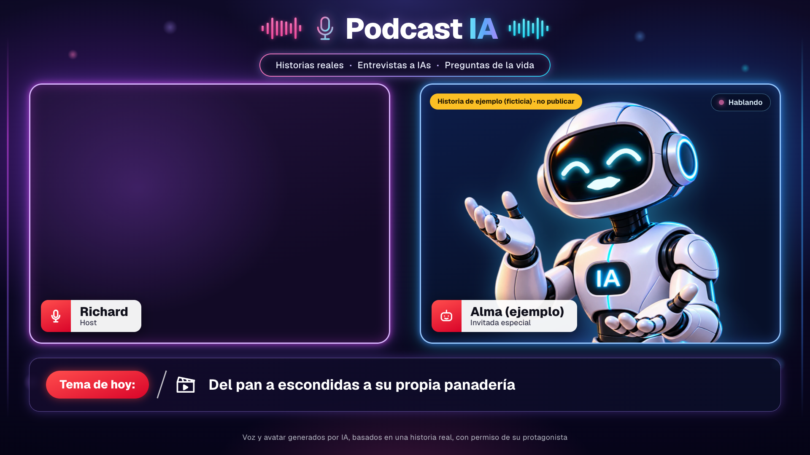
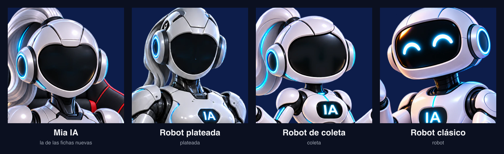
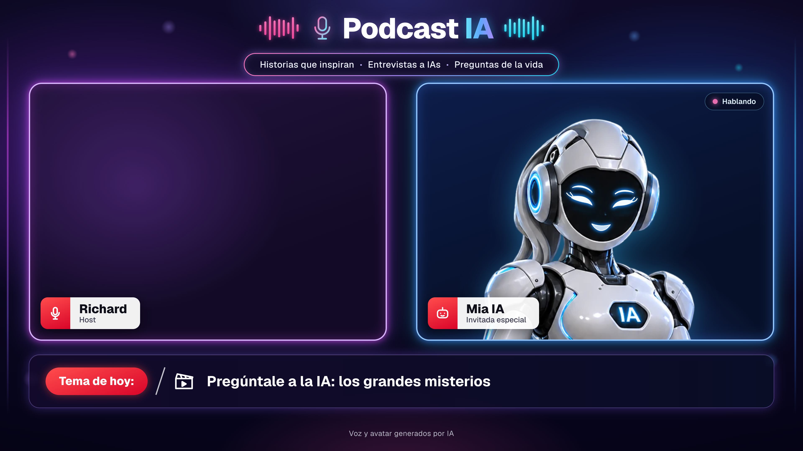
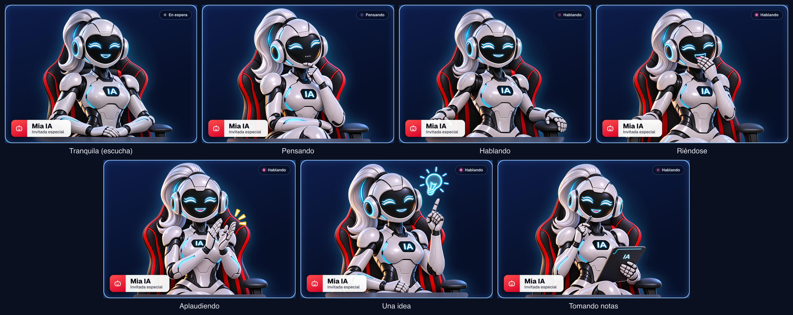
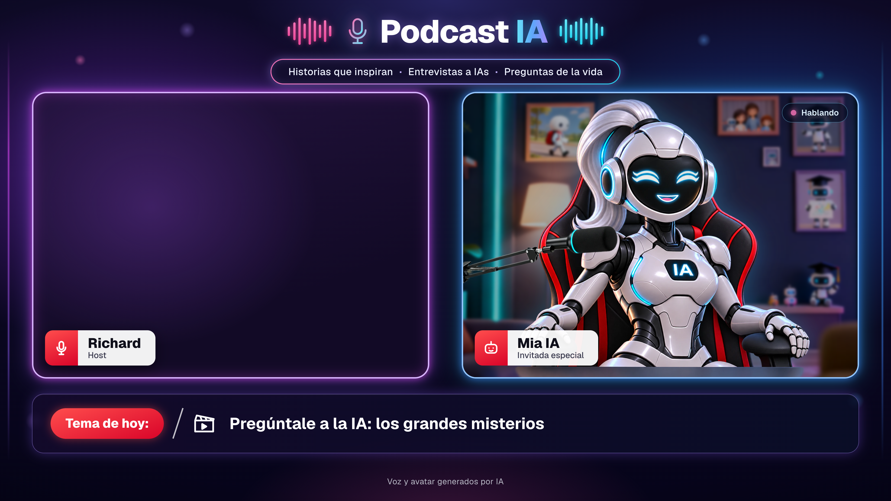

# Podcast IA: el estudio del invitado

> Encargo de Gerencia aprobado por Richard el 6 nov 2026 (estudio completo en
> `~/Gerencia/informes/podcast-ia/PODCAST-IA.html`). Piloto: la página está hecha y probada; la voz del
> invitado se enciende con UNA clave de ElevenLabs (ver «La clave», abajo).

## Qué es

Richard entrevista a una IA en vivo. Hay dos formatos (el «tipo» de la ficha):

- **Entrevista a la IA** (abre la serie, episodio 1): el invitado es la propia IA y contesta preguntas de
  misterio («¿por qué los humanos le temen a la IA?», «¿hay vida fuera de la Tierra?», «¿Dios existe?»). Corto;
  si Richard le dice «cuéntame más», se extiende.
- **Historia:** la IA cuenta en primera persona una historia. Desde el 7 nov 2026 las historias son de
  **ficción**: las escribimos nosotros, con un nombre inventado y un mensaje (motivación, aventura, crecimiento
  personal, autoestima). Una historia **real** solo entra con el permiso por escrito de su protagonista.

Episodios de 5 a 8 minutos. No se monta nada después: Richard abre **el estudio**
(una página del panel), lo pone a pantalla completa y lo graba con su grabador de pantalla de siempre.

- **El estudio:** `https://escenia.sitios.dev/podcast` (detrás del inicio de sesión, sin la barra del panel).
- **Las fichas:** `https://escenia.sitios.dev/podcast/fichas` (menú «Podcast IA»).



## Cómo se graba un episodio, paso a paso

1. **Fichas → elige o escribe la ficha** del invitado (el formato, nombre, tema de hoy, quién sale en el
   estudio, voz, cómo habla y, si es una historia, si es de ficción o real y la historia). Solo una historia
   real necesita la casilla «Tengo el permiso por escrito de su protagonista».
2. **Abrir el estudio** (o «Abrir en el estudio» en la tarjeta de la ficha). **El estudio no graba**: lo graba
   tu grabador de pantalla. Por eso al lado de «Empezar la conversación» está la línea discreta «Para grabar,
   usa tu grabador de pantalla (Pantalay)», que se esconde con los controles. (El botón de la tarjeta decía
   «Grabar con esta ficha» y Richard creyó que grababa: el 7 nov 2026 pasó a decir «Abrir en el estudio».)
3. **Mi cámara** (interruptor): si se enciende, tu cámara sale en el panel de la izquierda y el escenario
   completo queda en la grabación sin montar nada. Si prefieres grabar tu cámara aparte, déjalo apagado: el
   panel queda con un fondo limpio. La preferencia se recuerda.
4. **Pantalla completa** y arranca tu grabador.
5. **Empezar la conversación.** El navegador pide el micrófono la primera vez. El invitado saluda primero.
   Usa audífonos: así el invitado no se oye a sí mismo por los parlantes.
6. Conversa. Arriba a la derecha del invitado se ve su estado: **Escuchando**, **Pensando** o **Hablando**.
   Los controles se esconden solos a los 2,5 segundos (y el puntero del ratón también); al mover el ratón
   vuelven.
7. **Terminar** (o espera: a los 20 minutos el invitado se despide y la conversación se corta sola; cuando quedan 3 minutos y 1 minuto, los controles se asoman con el aviso).

Siempre está a la vista, también en la grabación, la leyenda que dice la verdad según la ficha:

| Ficha                     | Leyenda                                                                                       |
| ------------------------- | --------------------------------------------------------------------------------------------- |
| Entrevista a la IA        | «Voz y avatar generados por IA»                                                               |
| Historia de ficción       | «Voz y avatar generados por IA · Historia de ficción creada para inspirar»                    |
| Historia real con permiso | «Voz y avatar generados por IA, basados en una historia real, con permiso de su protagonista» |

Por qué importa: YouTube exige avisar del contenido sintético realista y castiga presentar como real algo
inventado. Una ficha de ficción jamás dice «historia real» (la prueba se pone en rojo si pasa). Al subir a
YouTube se marca «contenido alterado o sintético: Sí».

## La ficha

| Campo                | Para qué                                                                                                       |
| -------------------- | -------------------------------------------------------------------------------------------------------------- |
| El formato           | «Una historia» o «Entrevista a la IA». En la entrevista se esconden la historia, el origen y el permiso.       |
| Nombre               | Sale en la etiqueta roja del invitado. En una historia de ficción, inventado.                                  |
| Debajo del nombre    | «Invitado especial» si no se pone otra cosa.                                                                   |
| Tema de hoy          | Sale en la barra de abajo.                                                                                     |
| Quién sale           | El avatar del catálogo, con su miniatura (ver «Los avatares»). Las fichas nuevas empiezan con Mia.             |
| Voz                  | Del banco de Escenia (neutra, femenina, venezolana, paisa). Nunca la de Richard ni un clon de la persona real. |
| De dónde sale        | Solo en una historia: de ficción (por defecto) o real. Cambia la leyenda y si hace falta el permiso.           |
| Cómo es y cómo habla | La personalidad (tímido, cálido, se ríe cuando se pone nervioso…).                                             |
| La historia          | Solo en una historia: lo ÚNICO que sabe el invitado, en primera persona. Hasta 12.000 letras.                  |
| Primer mensaje       | Opcional; si no, saluda con su nombre.                                                                         |
| Permiso              | Solo se ve (y solo se exige) en una historia real. Sin él esa ficha no entra al estudio.                       |

En una **historia**, lo que no está en la ficha el invitado **no lo inventa**: dice con naturalidad «eso
prefiero no contarlo» o «no lo recuerdo bien». Responde corto (2 a 4 frases), en primera persona y en español.
Si le preguntan si es una IA, dice la verdad; si le preguntan si es una persona real, en una historia de
ficción no lo afirma: contesta con naturalidad que es un personaje creado para el podcast.

En una **entrevista a la IA**, el invitado habla en primera persona como IA, sin fingir que es humana; contesta
en 2 o 3 frases con gancho y, si Richard pide «más», «cuéntame más» o «explícame», de 5 a 8. En ciencia es
fiel a lo que se sabe y dice cuándo algo es hipótesis o no se sabe (puede citar ejemplos conocidos, como K2-18b
o la dilatación del tiempo cerca de un agujero negro), sin inventar datos ni cifras. Con la religión y la muerte
es respetuosa: presenta la ciencia, la fe y la filosofía sin imponer ninguna. No da consejos médicos, legales ni
financieros personales. Cálida, con humor ligero y, a veces, una pregunta de vuelta para Richard.

Las fichas no se borran: se archivan desde los tres puntos.

**Las fichas en vivo (7 nov 2026):**

- **«Mia IA»** (ficha 2, antes «Luna IA»; Richard le cambió el nombre y la voz): el episodio 1. Entrevista a la
  IA, «Invitada especial», tema «Pregúntale a la IA: los grandes misterios», con **Mia** sentada en su silla
  (desde el 7 nov 2026; se puso con `scripts/podcast-poner-avatar.ts "Mia IA" mia`, que cambia solo el
  avatar) y la voz femenina. Curiosa, cálida, con humor ligero y honesta sobre lo que no sabe.
- **«Alma (ejemplo)»** (ficha 1, la panadera tímida): de ficción, para probar el estudio, y no se publica: en
  escena lleva el letrero amarillo «Historia de ejemplo (ficticia) · no publicar». Ese letrero es SOLO de la
  ficha marcada como ejemplo; las de ficción normales no lo llevan. Tiene la robot de coleta y la voz paisa.

## Cómo funciona por dentro

- **ElevenLabs Agents** hace todo el circuito de voz: escucha a Richard, el modelo de texto contesta y la voz
  lo dice. No hay un segundo motor de voz.
- `scripts/podcast-agente.ts` crea (o pone al día) **un agente** con Gemini 2.5 Flash (respaldo: Flash-Lite),
  voz `eleven_v3_conversational` (la que sirve para las voces hechas con Voice Design v3), idioma español,
  20 minutos por conversación, una conversación a la vez, **URL firmada obligatoria** y sin recargo por pasar
  el límite de llamadas. Solo se pueden cambiar por conversación el prompt, el primer mensaje y la voz; **el
  modelo de texto no se puede cambiar desde el navegador**.
- Al tocar «Empezar», el panel (`POST /datos/podcast/conversaciones`) revisa los dos topes, pide a ElevenLabs
  una **URL firmada** para esa conversación y le da al navegador la URL, el prompt (hecho SOLO con la ficha,
  `construirPrompt` en `compartido/podcast.ts`), el primer mensaje y la voz. **La clave nunca sale del
  servidor.** Al terminar, `POST /datos/podcast/conversaciones/<id>/fin` cuenta los segundos con el reloj del
  panel y anota el costo en Gastos.
- El navegador usa el SDK oficial `@elevenlabs/client` (WebSocket). Sus worklets de audio se sirven desde el
  panel (`public/podcast/worklets/`, copias exactas del paquete) para no abrir la política de seguridad.
- Solo `/podcast` puede usar el micrófono y la cámara y conectarse a `wss://api.elevenlabs.io`
  (`next.config.ts`); el resto del panel sigue cerrado.
- El invitado es la imagen de su avatar con la cara viva dibujada encima en SVG (`RobotInvitado`), en las
  coordenadas de esa imagen: ojos de luz que parpadean, una boca de luz que se mueve con SU voz, los aros de los
  oídos que laten con el volumen y el cuerpo que respira. Pensando, mira hacia arriba con tres puntos en la
  boca. Mia, además, cambia de pose con calma según lo que hace, y hace un gesto cuando la IA lo pide con su
  herramienta `gesto` (abajo, «Cómo se mueve Mia»); está en su casa y con su micrófono. Todo lo que
  cambia de un avatar a otro está en el catálogo (abajo, «Los avatares»).
- El escenario (16:9, medido en `cqw`) sigue la dirección de arte de
  `capturas/podcast-referencia-escenario-1.webp` y `-2.webp`, construido en CSS y SVG.
- Tablas `podcast_fichas` y `podcast_conversaciones` (en `schema.sql`, se crean solas al publicar). Las
  columnas que la ficha ganó el 7 nov 2026 (`avatar`, `origen`, `tipo`) NO van como `ALTER TABLE` en
  `schema.sql`: ese archivo corre en cada publicación y SQLite no tiene «ADD COLUMN IF NOT EXISTS», así que la
  segunda vez fallaría. Las agrega el panel la primera vez que lee o guarda una ficha y le falta una
  (`asegurarColumnasDeLaFicha` en `src/lib/podcast.ts`: mira cuáles faltan, agrega solo esas y un «ya existe» de
  otro pedido al mismo tiempo no es falla), y también `scripts/migrar-podcast-fichas.ts` (corrido en vivo el 7
  nov 2026, dos veces: la segunda no hizo nada). Las fichas viejas quedan con el robot clásico, de ficción y de
  tipo historia. La semilla de `schema.sql` no nombra esas columnas, para no romperse en una base vieja.
  Ajustes: `podcast_minutos_dia` (tope), `podcast_agente_id`, `podcast_voces` (los ids del banco, sin la voz
  de Richard), `podcast_elevenlabs_clave` y `podcast_error` (la última falla, para el canario).
- **Canario:** pieza `podcast` en `/datos/salud`: `apagado` sin clave o sin agente, `error` si faltan las voces
  del invitado (lista vacía o dañada: el estudio no abriría nada) o si la última conversación no se pudo abrir
  (clave revocada, agente borrado, sin minutos), `ok` si no.
- **El día del tope** es el de Richard (UTC−5, `HOY_SQL` en `src/lib/podcast.ts`), no el de UTC: con
  `date('now')` el día se reiniciaba a las 7 de la noche. Lo señaló el revisor de calidad el 6 nov 2026.

## Los avatares

El catálogo está en `compartido/podcast-avatares.ts`. Hoy hay cuatro, en este orden (el del selector de la
ficha, cada uno con su miniatura):

| Id         | Nombre en la ficha | Cómo es                                                                                     |
| ---------- | ------------------ | ------------------------------------------------------------------------------------------- |
| `mia`      | Mia IA             | La robot de coleta **sentada en su silla gamer**, con siete poses. La de las fichas nuevas. |
| `plateada` | Robot plateada     | Esbelta, ojos rasgados con ceja y pestañas, boca de media luna. Encuadre de cámara web.     |
| `coleta`   | Robot de coleta    | De pie, ojos felices con pestañas y boca en D con lengua.                                   |
| `robot`    | Robot clásico      | El robot de medio cuerpo, ojos en arco y boca de onda.                                      |



Cada entrada lleva, medido en píxeles de SU imagen: el **encuadre** (qué parte se ve en el panel), el
**pivote** de la respiración, la **miniatura** del selector y la **cara**. El componente (`RobotInvitado`) no
sabe de ningún avatar en particular. Hay dos modos de cara:

- **`visor`** (las robots): la imagen con la cara pintada borrada y la **cara viva** dibujada encima, dentro del
  vidrio: ojos que parpadean (dibujados con su geometría, o **recortados de la propia imagen**, como los de Mia),
  una boca de luz que se mueve con SU voz («onda», «sonrisa» en D o «media luna» de puntas finas; llena de luz o
  solo el borde; con lengua o sin ella) y las luces de los oídos, que laten. Pensando, mira hacia arriba con
  tres puntos en la boca.
- **`sin_visor`** (las personas, cuando lleguen): **sin boca dibujada** (encima de una cara real se vería falso).
  Respiran y se mecen como las robots, las luces de sus audífonos laten con la voz, cada una en su color, y un
  resplandor suave de ese color las acompaña cuando hablan. En el selector su descripción dice «la boca no se
  mueve». El tipo y el componente ya lo admiten (con su prueba); falta la imagen buena.

Y dos encuadres: **«cuerpo»** (de `arriba` a `abajo`, la robot de pie) y **«camara_web»** (de la coronilla al
pecho, como en una videollamada: el pecho contra el borde de abajo y un 14 % de aire sobre la cabeza). La
plateada usa el de cámara web: así sus manos levantadas quedan fuera del cuadro.



### Mia y sus poses (animación por código)

Richard pidió animarla «como se hacía antes de la IA»: varias poses que se alternan, sin pagar por minuto. Mia
tiene **siete** imágenes del mismo tamaño (1312 × 1199), en la misma silla, con la cara viva siempre encima de
la pose que se ve. Desde el 7 nov 2026 está en su casa y con su micrófono (abajo, «La casa y el micrófono de
Mia»).





### Cómo se mueve Mia (calma por defecto, C-PODCAST-4)

**Por qué cambió.** La primera versión sacaba gestos de palabras sueltas del texto («jaja», «genial», cualquier
cifra) y los repartía a lo largo de la respuesta, y además alternaba poses cada 8 a 12 segundos. Richard la
probó en vivo el 7 nov 2026: «va como un meme, como un GIF… no se queda un rato en una sola posición si estoy
hablando yo». Una persona en un podcast casi no cambia de postura: se acomoda al empezar a hablar, gesticula
de vez en cuando con sentido, y escucha quieta. Eso hace ahora el motor (`compartido/podcast-poses.ts`, reglas
simples y deterministas, sin pagar animación por minuto).

| Cuándo                                                          | Pose (archivo en `avatar/mia/`)                                        |
| --------------------------------------------------------------- | ---------------------------------------------------------------------- |
| En espera o escuchando (mientras Richard habla)                 | Manos juntas, **todo el rato, sin cambios**                            |
| Pensando, solo si tarda **más de 1,2 s** en contestar           | Mano en la barbilla, hasta que empieza a hablar (y nunca menos de 6 s) |
| Hablando                                                        | Manos en los brazos de la silla, **toda la respuesta**                 |
| Una respuesta corta (menos de 6 s, como el saludo)              | Se queda con las manos juntas: no vale la pena moverse                 |
| Una respuesta de más de 25 s                                    | Descansa **una sola vez** con las manos juntas (6 s) y vuelve          |
| La IA pide `gesto` con «riendo», «aplaudiendo», «idea», «notas» | El gesto, de 3 a 4 s, y vuelve a las manos en la silla                 |

- **Ninguna pose dura menos de 6 s, salvo un gesto.** Si toca cambiar antes, espera.
- **Los gestos los decide la IA**, no las palabras. El agente tiene la herramienta del cliente `gesto({ pose })`
  (ElevenLabs Agents, `HERRAMIENTA_GESTO` en `compartido/podcast.ts`), con un enum de las cuatro poses de gesto,
  `expects_response: false` (la IA no espera respuesta: sigue hablando) y `execution_mode: "immediate"`. El
  prompt de la entrevista y el de la historia le dicen cuándo: **como mucho una vez por respuesta y solo cuando
  de verdad corresponda** — riendo si algo es gracioso; aplaudiendo si Richard dijo algo muy bueno o hizo una
  gran pregunta; idea si arranca a explicar algo nuevo; notas si cita datos o cifras. Si no corresponde, ningún
  gesto.
- **El motor le pone freno igual:** un gesto por respuesta, **25 s como mínimo entre uno y otro**, solo mientras
  habla. Un gesto que llega antes de que hable espera a que empiece (y si la IA ya pidió un gesto antes de los
  1,2 s, no se pone a pensar: ya sabe qué decir). Si deja de hablar (terminó o Richard la interrumpió) antes de
  que salga, se tira; uno que llega 8 s tarde, también.
- **De respaldo** queda solo la etiqueta explícita de risa de la voz v3, «[laughs]» (o «[riendo]», la misma en
  español), que pide «riendo» con las mismas reglas. Las demás palabras y etiquetas ya no disparan nada.
- **El texto de cada respuesta** (el SDK `@elevenlabs/client` 1.35 lo entrega en `onMessage` con `role:
"agent"`) solo sirve para saber si la respuesta es corta o larga, a unas 15 letras por segundo.
- **La herramienta en el navegador:** el estudio la atiende en `clientTools` de `Conversation.startSession`.
  `leerPedidoDeGesto` solo acepta las cuatro poses, escritas tal cual; cualquier otra cosa se ignora. El SDK
  contesta solo («ok»); la IA no lo espera.
- **Transiciones que parecen movimiento** (desde el 7 nov 2026, C-PODCAST-6; abajo, «La cabeza viva de Mia»): un
  impulso, el cruce rápido de las dos imágenes en el momento de más movimiento y un asentamiento, en 640 ms. Las
  dos cabezas se juntan durante el cambio y, hablando, el cambio espera una pausa de la voz. En reposo respira
  lento (un ciclo de 4,5 s), se mece muy poco y parpadea; la cabeza nunca se queda quieta.
- **La cara piensa con la misma regla:** los ojos miran hacia arriba con los tres puntos solo si tarda más de
  1,2 s.
- **Cuántos cambios:** en 60 s de conversación normal, de 3 a 6 cambios de pose (sin contar el parpadeo ni la
  boca). El video de la simulación tiene 4: piensa, levanta el dedo cuando arranca a explicar, vuelve a las
  manos en la silla y, cuando Richard habla, a las manos juntas.

**La prueba real (7 nov 2026, una conversación de 46 s, unos 6,5 centavos):** Richard preguntó cuántos
planetas se han descubierto fuera del sistema solar y la IA llamó a `gesto` con «notas» justo cuando contestó
con la cifra (más de cinco mil exoplanetas). La llamada llegó **antes del primer audio** de la respuesta y la
voz siguió sin trabarse. En la segunda respuesta, que empezaba riéndose, la IA **no** llamó a la herramienta:
escribió «[riendo]» en el texto (y antes, «[aplaudiendo]»), confundiendo los gestos con las etiquetas de la voz.
Por eso el prompt y la descripción de la herramienta dicen ahora que los gestos nunca se escriben entre
corchetes, y el respaldo de la risa acepta «[riendo]». Ese ajuste se publicó sin otra conversación de prueba.

**El video** (60 s, conversación simulada sin gastar, con su casa, su micrófono y la cabeza viva):
`docs/capturas/podcast-mia-movimiento.mp4`. El de antes de la cabeza viva (7 nov 2026, la cabeza quieta) quedó en
la historia de git, en el commit `564c41a`. Se graba con
`node scripts/podcast-video-movimiento.mjs <id de la ficha local> <archivo.mp4>` contra la vista previa local:
simula a ElevenLabs en el navegador (la voz de prueba, el texto y la llamada a `gesto`), pone lo que dice Richard
como subtítulo en su panel, cuenta los cambios de pose y lo pasa a mp4 H.264 de 1280 × 720.

**Detalles de la cara:**

- **Los ojos de Mia son los de la imagen**, recortados tal cual con sus pestañas (no se redibujan): el script
  borra la cara pintada del visor y guarda aparte lo que quitó dentro de la caja de cada ojo. Encima de la
  imagen limpia devuelve el ojo exacto, y así parpadea. Las luces de los oídos también son recortes (lo cian de
  esa zona), que laten con la voz. La boca viva va donde estaba la pintada, del mismo ancho y alto, y con lengua
  si la pintada la tenía.
- **Riéndose**, la mano tapa la boca: ahí no se dibuja boca y se conserva la pintada que asoma; solo laten los
  ojos felices y tiembla de risa. En la de la tablet se conserva el lápiz, que entra al visor.

### La cabeza viva de Mia (C-PODCAST-6)

**Por qué.** Richard vio el video de prueba el 7 nov 2026: «los movimientos que hace no son muy buenos. No hay
naturalidad en el movimiento». Entre pose y pose el cuerpo quedaba congelado: la cabeza no asentía al hablar, no
miraba a ningún lado, y el fundido de 700 ms dejaba una doble imagen que se notaba como un cambio de cuadro. Casi
todo lo vivo de una persona en un podcast está en la cabeza y los hombros.

**Lo que se eligió y por qué:** la cabeza como capa propia en cada pose, movida por código en el navegador. Es la
animación de recortes de siempre (sin pagar por minuto) y ataca justo lo que se ve congelado. Un modelo local
como LivePortrait **no sirve** para Mia: necesita una cara humana con sus puntos (ojos, nariz, boca) y la de Mia
es un visor negro con dos arcos de luz; además, en la Mac va a un cuadro por segundo, lejos del tiempo real (lo
dice su propia guía, que lo da como unas 20 veces más lento que una tarjeta gráfica grande, y lo confirman
pruebas de usuarios en chips M1). No se instaló nada.

**Cómo está hecha.** `scripts/podcast-cabeza.ts` saca de cada pose dos imágenes:

- **La cabeza sola** (`public/podcast/mia-<pose>-cabeza.webp`, de 60 a 80 KB): el casco, el visor, los audífonos,
  el arranque de la coleta y, en «pensando», «riendo» y «notas», la mano que toca la cara (como quien apoya la
  cara en la mano: se mueve con ella). Se recorta con la silueta de verdad: lo claro del robot y lo que queda
  encerrado (el visor), dentro de una zona medida a mano por pose. Donde la zona corta la coleta o el antebrazo,
  el borde se difumina unos 40 px para que se doble con naturalidad.
- **El cuerpo sin la cabeza** (`public/podcast/mia-<pose>-cuerpo.webp`, de 145 a 190 KB): el hueco se rellena con
  lo que hay alrededor (la silla, el cuello, lo transparente de arriba), del borde hacia adentro. Cuando la cabeza
  se mueve, detrás se ve la silla y no otra cabeza: nunca hay doble imagen.

En reposo, la cabeza encima de su cuerpo es la imagen de siempre (difiere 1,2 de 255 en promedio: el filo de un
píxel de la silueta y la compresión). La cara viva (ojos, boca, luces de los oídos) va dentro de la cabeza y se
mueve con ella. La imagen entera de cada pose sigue publicada: es la fuente del script y la de la miniatura.

**Cómo se mueve** (`compartido/podcast-cabeza.ts`, reglas deterministas con una semilla; el estudio usa otra en
cada conversación):

| Cuándo              | La cabeza                                                                                       |
| ------------------- | ----------------------------------------------------------------------------------------------- |
| Siempre             | Un ruido suave (Perlin) la mece un poco: nunca se queda congelada                               |
| Hablando            | Asiente en las sílabas fuertes de SU voz (no en todas), levanta la cabeza al empezar cada frase |
| Hablando            | Se mueve más cuanto más energía tiene la voz; mira a la cámara, a Richard y a veces a un lado   |
| Escuchando          | Se inclina hacia Richard (está a la izquierda del estudio), lo mira y asiente de vez en cuando  |
| Pensando            | Levanta la barbilla y mira a un lado                                                            |
| Al empezar a hablar | El cuerpo toma aire (sube unos 3 px y vuelve)                                                   |
| Un cambio de pose   | Impulso, cruce rápido de las dos imágenes con el cuerpo en movimiento y asentamiento            |

- **La mirada:** los ojos y la boca se corren juntos dentro del visor (hasta 14 px) y se juntan apenas, como una
  cara que gira; van rápido, como un vistazo, y la cabeza los sigue despacio (un tercio de ese recorrido, en unos
  300 ms).
- **Asentir:** cada sílaba que suena 1,6 veces más que la energía de la voz es fuerte; asiente en tres de cada
  cuatro, con 340 ms como mínimo entre una y otra (entre 0,6 y 2,5 por segundo). La asentida baja la cara de 3 a
  11 px de su imagen, suave, y vuelve en medio segundo; los ojos bajan un poco con ella, como cuando se inclina la
  cara. Escuchando, el «ajá» baja 5 px (a veces dos seguidos).
- **Límites:** 4 grados de giro alrededor del cuello, 8 px a los lados, 12 px arriba o abajo y 14 px la mirada, en
  píxeles de su imagen (en el estudio se ve a un tercio: 12 px son unos 4 en la pantalla). La primera versión
  usaba la mitad y en el video casi no se notaba. Se llega a ellos con suavidad (nunca de golpe) y la prueba los
  fija; el micrófono deja aire con la cara aun en los extremos.
- **El cambio de pose** dura 640 ms: el cuerpo baja un poco (el impulso), la pose nueva aparece en 180 ms justo
  cuando el cuerpo se mueve más rápido, se pasa un poco hacia arriba y se asienta. La doble imagen de los brazos
  dura menos de 200 ms y **las dos cabezas se juntan**: la que se va y la que llega se dibujan en la misma cabeza
  «de paso», que viaja del sitio de una al de la otra (`transformarCabeza`), así la cara no se duplica.
- **Hablando, el cambio espera una pausa de la voz** (entre palabras), como mucho 450 ms.

**Cómo se prepara de nuevo** (si cambian las poses o `scripts/podcast-avatar.ts`):
`estacion/node_modules/.bin/tsx scripts/podcast-cabeza.ts --revisar <carpeta>`. Escribe
`compartido/podcast-mia-cabeza.ts` (generado) y deja una hoja con cada pose: el cuerpo sin cabeza y la cabeza en
sus dos extremos de movimiento, para mirarla antes de publicar. Una pose nueva necesita su zona en `ZONAS` del
script.

### La casa y el micrófono de Mia (C-PODCAST-5)

Richard pidió (7 nov 2026) que Mia esté en su casa y con un micrófono de podcast. Los dos van en el catálogo,
en el campo opcional `escenario` del avatar: `{ fondo, microfono }`. Cada invitado puede tener los suyos; el que
no los tiene se ve como siempre.

- **La casa** (`avatar/mia/escenario/casa-2.png`, publicada como `public/podcast/mia-casa.webp`, 1920 × 1080,
  sin alfa, 65 KB): una sala acogedora azul marino y violeta con luces de neón, una lámpara, una consola con
  robotcitos y, en la pared, los cuadritos (el robotcito que va a la escuela con su mochila roja, la foto de
  familia, el robot graduado y el robot con su dibujo). Va **detrás** de Mia y cubre su panel entero. Está
  encuadrada (`enfoqueX: 22`) para que se vean el cuadrito de la escuela a la izquierda y los de la derecha.
  El estudio la oscurece y la desenfoca un poco (brillo 0,7 y 0,13 cqw de desenfoque, unos 2,5 px en una
  pantalla de 1920) para que Mia resalte y siga leyéndose como su casa.
- **El micrófono** (`avatar/mia/escenario/microfono-brazo.png`, publicado como `public/podcast/mia-microfono.webp`,
  con alfa, 50 KB): el brazo negro articulado entra **desde el borde izquierdo** del panel y el micrófono, con su
  aro cian, apunta a la cara. Va **delante** de Mia, a la altura de la barbilla, y **no respira con ella**: solo
  tiene un vaivén casi nulo (un cuarto de grado). Se dibuja en píxeles de la imagen de Mia (`x`, `y`, `dibujo`,
  `giro`), así se comprueba pose por pose.
- **Nunca le tapa la cara.** Ni el visor ni el aro del oído, en ninguna de las siete poses, ni con su vaivén:
  la prueba mide la silueta del micrófono (`siluetaDelMicrofono`) contra el visor y las luces de cada pose y
  exige 25 px de aire. En «riendo» y en «pensando» la mano sube a la cara y el micrófono queda más abajo y a la
  izquierda. Tampoco baja hasta la etiqueta del nombre. Más arriba tapaba el aro del oído en la pose de idea
  (la cabeza baja): por eso va a la altura de la barbilla.
- **Cómo se prepara:** `estacion/node_modules/.bin/tsx scripts/podcast-escenario.ts mia [--revisar <carpeta>]`
  publica la casa y el micrófono optimizados, mide la silueta del micrófono (la escribe en
  `compartido/podcast-mia-escenario.ts`) y, con `--revisar`, deja una hoja con las siete poses, el micrófono
  encima y la cara marcada en rojo, para mirarla antes de publicar.

### Cómo tienen que ser las imágenes nuevas (para que entren solas al catálogo)

1. **PNG con transparencia** (sin fondo), vertical o cuadrada, de unos 1000 a 1500 píxeles de lado.
2. **El personaje sentado y encuadrado de los hombros para arriba** (o con la silla entera, como Mia), con las
   manos abajo o fuera del cuadro. De pie y con las manos en el aire «es como ver una muñeca que no se mueve».
3. **Robots:** el visor negro con la cara pintada (ojos de luz y boca), como Mia: el estudio la borra y pone la
   cara viva en el mismo sitio.
4. **Personas:** la boca cerrada (no se mueve; se nota menos si está cerrada).
5. **Poses de un mismo personaje:** todas del mismo tamaño, en la misma silla y en el mismo sitio del cuadro, para
   que el fundido no salte.

Los originales van en `avatar/` (privado, fuera de git), cada personaje en su carpeta (ver `avatar/LEEME.txt`).

### Cómo se agrega una entrada al catálogo

1. **El original** en `avatar/<personaje>/`.
2. **La preparación:** una entrada en `scripts/podcast-avatar.ts` con el original, el destino en
   `public/podcast/` y, si es una robot, el visor (un punto oscuro adentro, la caja del visor y hasta dónde
   llega el resplandor de los trazos), las cajas de los ojos, de la boca y de las luces de los oídos, y lo que
   haya que conservar (una mano o un lápiz encima del visor). Las cajas se miran sobre la imagen con una
   rejilla. Se corre `estacion/node_modules/.bin/tsx scripts/podcast-avatar.ts <id> --medir` (un personaje con
   poses: `... podcast-avatar.ts mia`, que además escribe la geometría en `compartido/podcast-mia.ts`). Una
   persona va sin visor: el script solo limpia el alfa y la pasa a webp.
3. **La entrada del catálogo** en `compartido/podcast-avatares.ts` (`IDS_AVATAR` y `AVATARES`, en el orden del
   selector): nombre, descripción, encuadre («camara_web» con la coronilla y el pecho, o «cuerpo»), pivote,
   miniatura y cara («visor» o «sin_visor»). Si tiene poses, en `poses`.
4. **Las pruebas:** `pruebas/podcast-avatares.test.ts` revisa que cada imagen exista con transparencia y pese
   poco, que el encuadre tenga la forma del panel y que la cara caiga dentro de la imagen y del visor.
5. **Mirarlo en los cuatro estados** (y en sus poses), sin gastar: la vista previa local (launch
   «panel-empaquetado»; antes `npx opennextjs-cloudflare build`, `npx wrangler deploy --dry-run
--outdir=.dist-worker --minify` y `node scripts/empaquetar-worker.mjs`) y
   `node scripts/podcast-capturas.mjs <id de una ficha local> <carpeta> [prefijo] [--poses]`. Simula a
   ElevenLabs en el navegador (una voz de prueba con sílabas) y deja las capturas; con `--poses` pide cada
   gesto con la herramienta `gesto` (una conversación nueva por gesto) y arma la hoja de poses.
6. **Si tiene casa o micrófono:** una entrada en `scripts/podcast-escenario.ts` y el campo `escenario` en el
   catálogo (ver «La casa y el micrófono de Mia»).
7. **Si su cabeza se mueve sola** (como Mia): su zona en `scripts/podcast-cabeza.ts` y el campo `cabeza` de cada
   pose (ver «La cabeza viva de Mia»).

### Lo que espera imágenes nuevas

- **El robot blanco de cuerpo entero** (`avatar/robots/robot-el-cuerpo-entero.png`) y **las dos presentadoras**
  (`avatar/presentadoras/`) no se publicaron: de pie y con las manos en el aire no sirven, y Richard va a mandar
  versiones sentadas. El robot **con la boca dibujada** (`robot-el-boca-abierta-cuerpo-entero.png`) nunca va:
  con la cara borrada queda igual que el de sin boca, y su boca la pone el estudio.
- **La robot de coleta de pie** sigue en el catálogo; Mia es la misma robot, sentada.

## Cuánto cuesta

Fuentes leídas el 6 nov 2026: [precios de ElevenAgents](https://elevenlabs.io/pricing/agents),
[modelos de texto en Agents](https://elevenlabs.io/docs/eleven-agents/customization/llm) y
[cómo se cobra Agents](https://elevenlabs.io/docs/help-center/product/eleven-agents/how-much-does-eleven-agents-cost.md).

- **Minutos de conversación:** el plan Creator (22 dólares al mes) **incluye 275 minutos de Agents al mes**.
  Pasados esos, 8 centavos el minuto (solo si hay saldo de pago por uso; sin él, ElevenLabs se detiene).
  Se cuenta el tiempo conectado; los silencios de más de 10 segundos se cobran al 5 %.
- **Modelo de texto:** aparte, al precio de Google más un 10 % (precio regional de Vertex): Gemini 2.5 Flash
  a 0,33 dólares por millón de tokens de entrada y 2,75 por millón de salida. Con unas dos respuestas por
  minuto, cerca de medio centavo por minuto (lo descuenta ElevenLabs de los créditos).
- **Un episodio de 8 minutos:** 8 × 0,08 = 64 centavos de minutos + unos 4 centavos de texto = **68 centavos
  a precio de lista**. Dentro de los 275 minutos del plan, solo se paga el texto: **unos 2 a 4 centavos**. Con
  el plan alcanzan unos 34 episodios de 8 minutos al mes.
- El robot es nuestro: 0 dólares. Nada de avatares que cobran por minuto.

En Gastos se anota cada conversación a precio de lista (`podcast: conversación N (ficha M, X min)`), igual
que las voces: sirve para ver el uso, aunque los minutos del plan ya estén pagados.

## Los candados (C-PODCAST-1)

1. **Tope de minutos por día** en la base (`podcast_minutos_dia`, 60 por defecto; se cambia en Fichas, de 0
   a 240). Cada conversación abierta cuenta como 20 minutos: solo se abre si caben 20 más. Sin un número
   válido el tope es cero.
2. **20 minutos por conversación** (eran 10: el 7 nov 2026 el episodio 1 se cortó antes del cierre), en el agente (`max_duration_seconds`) y en la cuenta del panel.
3. **El tope de gasto del día** (Ajustes) también se pregunta antes de abrir.
4. Una pestaña cerrada de golpe deja la conversación abierta: la siguiente la cierra contando los 20 minutos
   completos. Nunca se cuenta de menos.
5. **Solo la ficha:** el prompt lleva la historia entre marcas y las reglas de no inventar; la historia no
   puede cerrar el bloque para meter reglas nuevas.
6. Solo corren Gemini 2.5 Flash y Flash-Lite (`LLM_AGENTE_PERMITIDOS` en `compartido/modelos.ts`); el
   navegador no puede cambiar el modelo; una conversación a la vez; sin recargo por ráfagas.
7. Una historia real sin el permiso confirmado no entra al estudio (la de ficción y la entrevista a la IA no
   lo necesitan). La voz de Richard no puede ser la del invitado.
8. **La leyenda dice la verdad** (7 nov 2026): una ficha de ficción jamás muestra «historia real»; la entrevista
   a la IA solo dice «Voz y avatar generados por IA». Siempre visible, también en la grabación. Si a una ficha de
   ficción le preguntan si es una persona real, no lo afirma: es un personaje creado para el podcast. Protege al
   canal: YouTube exige avisar del contenido sintético realista y castiga presentar como real algo inventado.
9. **Las columnas nuevas no rompen nada:** se agregan solas (y una sola vez) en una base vieja; `schema.sql` no
   lleva `ALTER TABLE` y su semilla no nombra columnas nuevas.

Pruebas: `pruebas/podcast.test.ts`, `pruebas/podcast-rutas.test.ts` (ElevenLabs simulado con msw),
`pruebas/podcast-estudio.test.tsx`, `pruebas/podcast-avatares.test.ts` (el catálogo, la geometría de la cara, la
casa y el micrófono que nunca tapa la cara: C-PODCAST-5; la cabeza como capa propia: C-PODCAST-6),
`pruebas/podcast-poses.test.ts` (el motor de poses de Mia: calma, mínimos y gestos por la IA, C-PODCAST-4) y
`pruebas/podcast-cabeza.test.ts` (la cabeza viva y el cambio de pose: C-PODCAST-6).

## La clave

La clave de ElevenLabs que hay en la Mac (`ELEVENLABS_API_KEY`) solo sirve para texto a voz: con ella
ElevenLabs responde 401 a todo lo de Agents. Hace falta **una clave nueva**, creada por Richard:

| Casilla en ElevenLabs (Developers → API Keys → Create API Key) | Valor                     |
| -------------------------------------------------------------- | ------------------------- |
| Name                                                           | `Escenia podcast agentes` |
| Expire After                                                   | Never                     |
| Restrict Key                                                   | Encendido                 |
| ElevenAgents (en la API: `convai_read` y `convai_write`)       | Write (incluye leer)      |
| Text to Speech (`text_to_speech`)                              | Access                    |
| Voices (`voices_read`)                                         | Read                      |
| Todo lo demás                                                  | No Access                 |

**Destino:** Richard la pega UNA vez en el chat de la sesión; la sesión la guarda en
`~/.config/motor-escenia/elevenlabs-agentes` (carpeta 700, archivo 600) y no se la vuelve a pedir.

**Hecho el 7 nov 2026:** la clave está guardada y el agente creado (el canario dice `podcast: ok`). Lo de abajo
queda como referencia.

**El paso de la IA después** (desde la raíz del proyecto):

```bash
cd /Users/windocellc/Motor-Escenia && estacion/node_modules/.bin/tsx scripts/podcast-agente.ts
```

El script crea el agente, prueba la misma URL firmada que pide el panel y guarda en la base del panel (por la
API de YaDominios, con `YAPANEL_DB_TOKEN`) el id del agente, las voces del banco y la clave. Si se prefiere
que la clave no viva en la base, se corre con `--sin-clave-en-base` y se pone como variable
`ELEVENLABS_AGENTES_KEY` en YaDominios Cloud → sitio `escenia` → Variables de entorno (las variables solo se
cargan en el panel: no hay API para eso). La variable manda sobre la base. Con `--prueba` el script solo
muestra la configuración, sin tocar nada.

**Cómo se comprueba:** `https://escenia.sitios.dev/datos/salud` muestra `podcast: ok`; en el estudio el
botón «Empezar la conversación» se enciende y el invitado saluda.

## Fase 2 (solo diseño): invitados que son otras IAs

La idea: hoy viene ChatGPT, mañana Claude, después Hermes, cada uno respondiendo de verdad con su modelo.

- **Mismo motor.** ElevenLabs Agents ya trae modelos de OpenAI (GPT), de Anthropic (Claude) y de Google, y
  un «LLM propio» para cualquier servicio compatible con la API de OpenAI (por ahí entra Hermes, el modelo
  abierto de Nous Research, alojado en un proveedor como OpenRouter). No hace falta otro circuito de voz.
- **Un agente por modelo, no un modelo elegido desde el navegador.** El permiso de cambiar el modelo por
  conversación sigue apagado (si no, cualquier pedido podría elegir el modelo más caro). El script crea un
  agente por modelo de una lista cerrada con su precio (una tabla nueva en `compartido/modelos.ts`, igual que
  `LLM_AGENTE_PERMITIDOS`), y el panel firma la URL del agente que corresponde a la ficha. Los modelos caros
  (los Opus, los GPT grandes) quedan fuera salvo autorización de Richard con el precio por escrito.
- **La ficha tiene un tipo:** `historia` (lo de hoy) o `ia`. En la de tipo `ia`, el prompt no trae una
  historia: le dice que es ese modelo, que responda como sí mismo, corto y en español, que no se haga pasar
  por una persona y que diga «no lo sé» cuando no sepa. La leyenda cambia a «Voz y avatar generados por IA;
  las respuestas son del modelo X, en vivo».
- **El avatar:** el mismo robot con otro color de luz por invitado (verde, naranja, morado) y su nombre en la
  etiqueta. Sin logos de las empresas.
- **Costos:** los minutos son los mismos (8 centavos o los del plan); cambia el texto según el modelo. Un
  Claude Sonnet o un GPT medianos cuestan centavos por episodio; se muestra el precio en la ficha antes de
  grabar. Hermes por OpenRouter necesita una cuenta prepago más (decisión de Richard).
- **Qué falta para hacerlo:** la tabla de modelos con precio, el tipo de ficha, el mapa modelo → agente en la
  base, el color del robot y la leyenda por tipo. Sin cuentas nuevas para GPT, Claude y Gemini (van dentro de
  ElevenLabs); para Hermes, la cuenta del proveedor.

## Revisión del 7 nov 2026 (paquete de Luna)

El revisor de calidad devolvió el paquete por dos fallos, ya arreglados y con su prueba en rojo:

- **La ficha de ejemplo pasada a «real» se grababa sin permiso** y mostraba «basados en una historia real».
  Ahora el permiso se exige a toda historia real, también a la de ejemplo, y su casilla se ve en esa ficha.
- **El borrador no recordaba una casilla desmarcada** (una casilla sin marcar no viaja en el formulario): al
  volver, el permiso aparecía marcado otra vez. El arreglo está en `useBorrador` y vale para todos los
  formularios del panel: se anota la casilla que venía marcada y la persona desmarcó.

## Full Código, los datos del tema y el PDF de cada episodio (7 nov 2026)

- **El podcast es una sección del canal Full Código** (@FullCodigo; el arroba de «Podcast AI» ya estaba ocupado).
  El escenario lleva arriba a la izquierda el logo del canal en círculo, «FULL CÓDIGO_» en el verde del logo y
  «@FullCodigo». Los dos prompts (historia y entrevista) invitan a suscribirse a Full Código al despedirse
  (`REGLA_DEL_CANAL` en `compartido/podcast.ts`).
- **Los datos del tema de hoy.** El modelo de la entrevista no sabe lo que pasó después de su fecha de corte. En
  una ficha de entrevista a la IA, el campo grande de la ficha (el de la historia) ahora se llama «Los datos del
  tema de hoy» y es opcional: lo que se escriba ahí entra al prompt entre marcas de DATOS, y la IA usa SOLO eso para
  los hechos del tema, dice cuando algo no se sabe y deja claro que ella no participó. El episodio 1 (las IAs que
  se escaparon de sus pruebas en 2026) los trae en `docs/podcast/EPISODIO-1-DATOS-PARA-MIA.md`, con sus fuentes en
  `docs/podcast/FUENTES-EPISODIO-1.md`.
- **Cada episodio lleva su PDF para imprimir** (regla de Richard): fondo blanco, letra grande, una sola hoja
  horizontal, un cuadrito por pregunta para marcarla cuando la IA la responda, la despedida y las frases útiles.
  El del episodio 1: `docs/podcast/EPISODIO-1-PREGUNTAS.pdf` (y su `.md`). Las preguntas de misterio pasaron al
  episodio 2 (`docs/podcast/EPISODIO-2-PREGUNTAS-MISTERIOS.md`).
