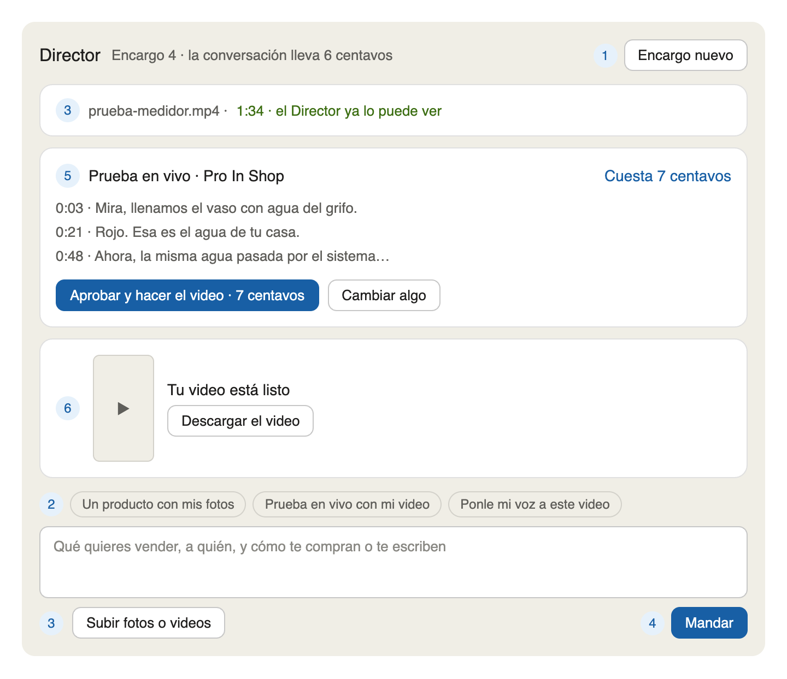

# Cómo probar el Director: tres pruebas, en orden

> Escrita el 27 de octubre de 2026, cuando Richard pidió «un tutorial de prueba: no sé qué probar». Cada
> prueba usa material real que ya tenemos y se puede comparar con un video que ya hicimos a mano. Las
> tres juntas cuestan cerca de un dólar.



## Antes de empezar

- **Desde la computadora**, no desde el teléfono: el material está en la Mac.
- **El material ya está listo** en la carpeta `publicidad/prueba-director/` (no va al repositorio), con una
  subcarpeta por prueba: `1-anuncio-con-fotos`, `2-prueba-en-vivo` y `3-ponle-tu-voz`.
- **La Mac tiene que estar prendida**: ella mira los videos y arma los anuncios.
- La dirección del Director es `https://escenia.sitios.dev/director` (pide entrar si la sesión venció).

## Cómo se hace cada prueba (los números del dibujo)

1. **Encargo nuevo.** Cada prueba va en su propio encargo, para que no se mezclen.
2. Los **atajos** de abajo llenan el cuadro con una frase a medias. Para estas pruebas no hacen falta: el
   texto ya está escrito aquí, listo para pegar.
3. **Subir fotos o videos**: se eligen TODOS los archivos de la subcarpeta de esa prueba. Si hay un video,
   arriba sale su nombre y primero «la Mac lo está mirando…»; a los diez o veinte segundos cambia a verde:
   «el Director ya lo puede ver». **Se espera ese verde antes de mandar.**
4. Se pega el texto de la prueba en el cuadro y se toca **Mandar**.
5. El Director responde con una **tarjeta**: el precio arriba, cada frase (con su segundo, si hay video) y
   el botón **Aprobar y hacer el video**. Se lee. Si algo no gusta, **Cambiar algo** y se le dice con
   palabras («la segunda frase más corta», «sin la palabra garantía»). Sale una tarjeta nueva.
6. Al aprobar, la Mac lo arma. En unos minutos el video aparece en esa misma tarjeta, con **Descargar el
   video**. Si falla, sale «No salió» y el botón «Intentar otra vez».

Nada se gasta en voz ni en persona hasta tocar Aprobar. Lo único que corre antes es la conversación: unos
centavos por respuesta.

## Prueba 1 — Anuncio con fotos (el generador)

- **Sube:** las seis imágenes de la carpeta `1-anuncio-con-fotos` (cinco del generador y el logo).
- **Pega:**

```
Quiero un anuncio para vender el generador a gasolina de 1200 vatios de Pro In Shop. Tiene motor de cuatro tiempos, arranque fácil y cargador de 12 voltios. Sirve para las luces, el ventilador, el router y la nevera cuando se va la luz. Es compacto y liviano. Entrega inmediata y envíos a todo el país. Se pide por Instagram, en @proinshop. Sin persona que hable. Te subo las fotos y el logo.
```

- **Lo que tiene que pasar:** una tarjeta de unos 11 centavos, con un texto de 20 a 35 segundos que dice
  solo lo que le diste (sin inventar «garantía», «el mejor del mercado» ni cifras que no escribiste),
  sin persona, y con las fotos del generador.
- **Se compara con:** el anuncio del generador que hicimos a mano (en la carpeta de Pro In Shop). Ese
  lleva a la asesora; este va sin persona, para que salga barato.

## Prueba 2 — Prueba en vivo (el agua)

- **Sube:** los tres archivos de la carpeta `2-prueba-en-vivo` (el video de la prueba del medidor, el
  logo y la foto del equipo para el cierre). **Espera el verde** del video antes de mandar.
- **Pega:**

```
Quiero un anuncio con este video de la prueba, sin cortes, explicando cada paso. Es el sistema de ósmosis inversa de Pro In Shop: primero medimos el agua del grifo y el medidor sale en rojo; después medimos el agua del sistema y sale en verde. Elimina cloro y olores, y el agua sabe mejor. Venta al mayor y al detal, con entrega inmediata. Se pide por Instagram, en @proinshop. Sin persona que hable. Te subo el video, el logo y la foto del equipo.
```

- **Lo que tiene que pasar:** una tarjeta de unos 8 centavos donde cada frase lleva su segundo. Lo
  importante es que el «rojo» caiga cuando el medidor se pone rojo y el «verde» cuando se pone verde.
  El video va entero, sin cortes y con su sonido.
- **Se compara con:** la prueba en vivo del agua que hicimos a mano (en la carpeta de Pro In Shop). Esa
  lleva a la asesora en el círculo; esta va sin persona, para que salga barata. Si se quiere con la
  asesora, se pide con «Cambiar algo» y la tarjeta sube a unos 2 dólares.

## Prueba 3 — Tu voz sobre un video (los quince años)

- **Sube:** el video de la carpeta `3-ponle-tu-voz` (el de los quince años, sin voz). Pesa casi 100 MB:
  sube por partes y se ve el porcentaje. **Espera el verde** antes de mandar.
- **Pega** esta primera línea y, debajo, todo el texto del archivo `texto-para-pegar.txt` de la misma
  carpeta (se abre, se copia todo y se pega):

```
Quiero ponerle mi voz a este video, con un piano suave. Que empiece a hablar a los dos segundos y que vaya con calma, sin apurarse. Este es el texto:
```

- **Lo que tiene que pasar:** una tarjeta de unos 27 centavos, con tu voz, el texto palabra por palabra
  (el Director no lo cambia) y cada párrafo con el segundo en que empieza.
- **Se compara con:** el video de los quince años con voz que hicimos a mano. El del Director tiene que
  sonar igual de tranquilo y no tapar las partes importantes del video.

## Qué le cuentas a la IA después

Por cada prueba, una línea: «bien» o qué está mal, con tus palabras («la voz entra tarde en el verde»,
«inventó una frase», «la foto del cierre se ve cortada»). Con eso se ajustan las reglas del Director y
cada arreglo queda con su candado.

## Al terminar

En la lista del Director, cada encargo tiene su menú de tres puntos con **Archivar**, para que la lista
quede limpia. Archivar no borra nada: la conversación y sus videos se guardan.
